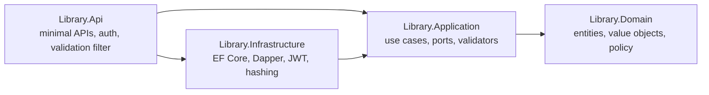

# Library API

[](https://github.com/SamMartins92/library-api/actions/workflows/ci.yml)

A lending library REST API built with **ASP.NET Core 10** and **Clean Architecture**: members borrow and return books, librarians manage the catalogue, and the lending rules live in a domain model that is tested on its own.

It runs on SQLite, so it works straight after cloning — no database server or Docker needed.

## Features

- **JWT authentication** with two roles: `Member` (self-registration) and `Librarian`
- **Catalogue** search by title, author or ISBN, with paging and an "available only" filter
- **Lending rules**: at most 3 books per member, 14-day loans, €0.50 late fee per started day, no new loans while a book is overdue, one copy of a title per member
- **ISBN-13 validation** including the check digit
- **Concurrency-safe checkout**: two members cannot both take the last copy
- **RFC 7807 problem details** for every error, with stable error codes
- **OpenAPI** document and an interactive API reference (Scalar) with bearer-token support

## Architecture



Dependencies point inwards: the domain has no dependencies at all, the application layer defines the interfaces it needs (repositories, queries, token service, current user) and the outer layers implement them.

| Layer | Contents |
|---|---|
| **Domain** | `Book`, `Member`, `Loan`, the `Isbn` value object, `LoanPolicy` (all lending rules in one place) and a small `Result`/`Error` type |
| **Application** | One class per use case (`BorrowBook`, `ReturnBook`, `AddBook`, `RegisterMember`, `Login`…), FluentValidation validators, read/write ports |
| **Infrastructure** | EF Core (SQLite) for the write side, Dapper for the read side, ASP.NET Core Identity password hasher, JWT issuing, migrations and seeding |
| **Api** | Endpoint groups, JWT bearer setup, authorization policy, a generic validation endpoint filter, `Result` → problem details mapping, OpenAPI |

## Design decisions

- **Business errors are values, not exceptions.** Use cases return `Result<T>`; the API maps `Error.Type` to 400/401/403/404/409. Exceptions are kept for bugs.
- **Lending rules in a single policy.** `LoanPolicy.Borrow` checks overdue loans, the loan limit, duplicates and availability in a fixed order, which makes the rules easy to read and to test exhaustively.
- **Light CQRS.** Commands load aggregates through EF Core repositories and save through a unit of work; queries use Dapper with hand-written SQL projected straight into response models.
- **Optimistic concurrency.** `Book.Version` is a concurrency token, so a checkout that raced another one becomes a `409 Conflict` instead of over-lending.
- **Time is injected.** Everything that depends on "now" — due dates, late fees and even token lifetime validation — uses `TimeProvider`, so tests can move the clock forward two weeks.
- **No account enumeration.** Login returns the same error for an unknown email and a wrong password.

## Getting started

Prerequisite: [.NET 10 SDK](https://dotnet.microsoft.com/download).

```bash
dotnet run --project src/Library.Api
```

On first start the database is created and, in Development, seeded with a few books and a librarian account (`librarian@library.local` / `Librarian123`, see `appsettings.Development.json`). Open `/scalar` for the API reference.

```bash
# sign in and borrow a book
TOKEN=$(curl -s -X POST localhost:5000/api/auth/login -H "Content-Type: application/json" \
  -d '{"email":"librarian@library.local","password":"Librarian123"}' | jq -r .token)
curl "localhost:5000/api/books?query=clean"
curl -X POST localhost:5000/api/loans -H "Authorization: Bearer $TOKEN" \
  -H "Content-Type: application/json" -d '{"bookId":"<id>"}'
```

The signing key in `appsettings.Development.json` is for local development only. In any other environment provide `Jwt__SigningKey` (32+ characters) through environment variables or a secret store; the app refuses to start without a valid one.

## API

| Method | Route | Access |
|---|---|---|
| `POST` | `/api/auth/register` | anyone |
| `POST` | `/api/auth/login` | anyone |
| `GET` | `/api/books?query=&availableOnly=&page=&pageSize=` | anyone |
| `GET` | `/api/books/{id}` | anyone |
| `POST` | `/api/books` | librarian |
| `POST` | `/api/books/{id}/copies` | librarian |
| `POST` | `/api/loans` | signed in |
| `POST` | `/api/loans/{id}/return` | the borrower or a librarian |
| `GET` | `/api/loans/mine` | signed in |
| `GET` | `/health` | anyone |

## Tests

```bash
dotnet test
```

| Project | What it covers |
|---|---|
| `Library.Domain.Tests` | ISBN parsing and check digit, every lending rule, late-fee calculation, returns |
| `Library.Application.Tests` | Use cases with NSubstitute: borrowing, policy violations, concurrency conflicts, registration, login |
| `Library.Api.Tests` | The real API in memory (`WebApplicationFactory`, in-memory SQLite, fake clock): full borrow/return flow, last-copy race, loan limit, overdue blocking and late fees, authorization, validation, OpenAPI |

## Tech stack

C# 14 · .NET 10 · ASP.NET Core minimal APIs · EF Core 10 (SQLite) · Dapper · FluentValidation · JWT bearer · ASP.NET Core Identity password hashing · OpenAPI + Scalar · xUnit · NSubstitute · GitHub Actions

## License

[MIT](LICENSE)
